### Maps and data stories

Map and data visualization designer. Earth scientist (PhD, ITU Istanbul).

**#30DayMapChallenge 2026**

<a href="https://oguzhankose.com/work/tsunami-monuments-of-northeast-japan/">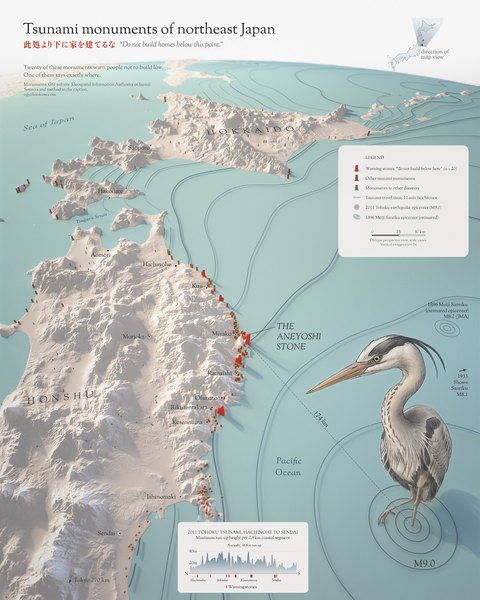</a>
<a href="https://oguzhankose.com/work/the-fault-walking-toward-istanbul/">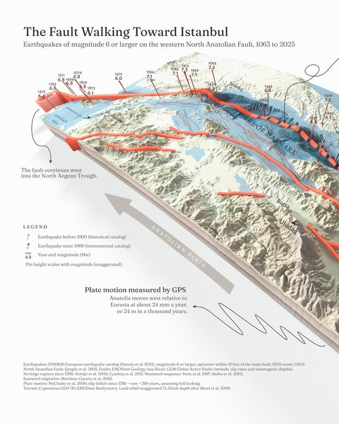</a>
<a href="https://oguzhankose.com/work/rain-has-favorites/">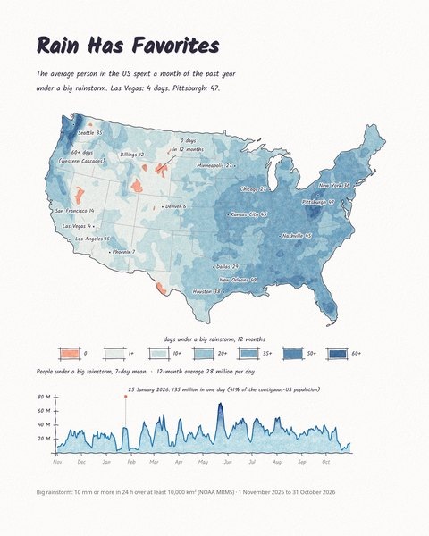</a>
<a href="https://oguzhankose.com/work/florida-sandcastles/">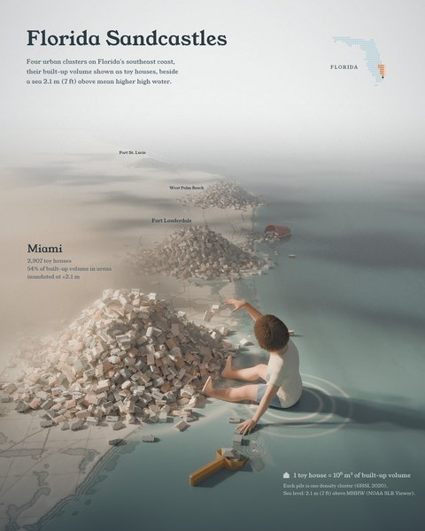</a>
<a href="https://oguzhankose.com/work/the-beacons-are-lit/">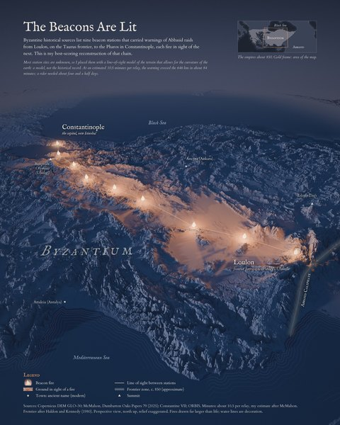</a>

<a href="https://oguzhankose.com/work/what-geology-knew-in-1855/">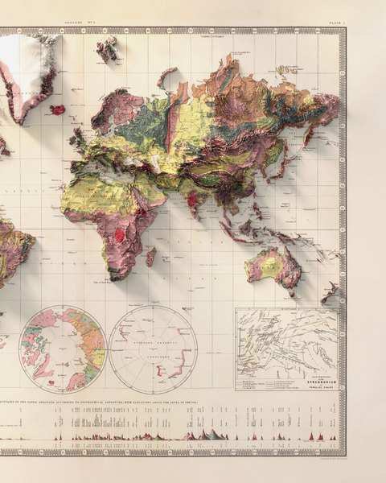</a>
<a href="https://oguzhankose.com/work/tropical-cyclones-bend-away-from-the-equator/">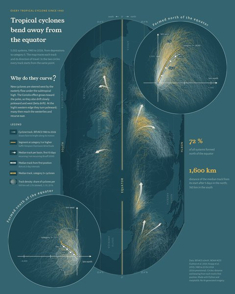</a>
<a href="https://oguzhankose.com/work/the-sea-that-already-drained/">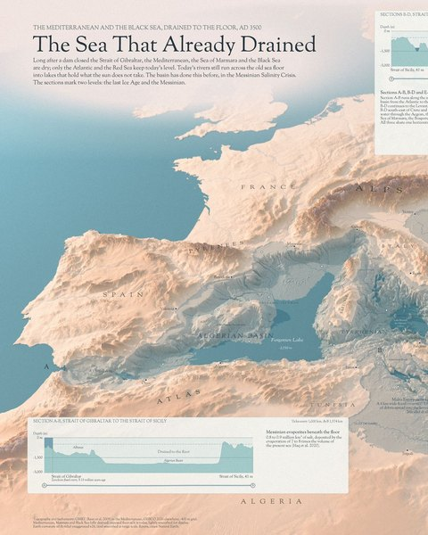</a>
<a href="https://oguzhankose.com/work/fifty-years-of-urbanization-in-turkiye/">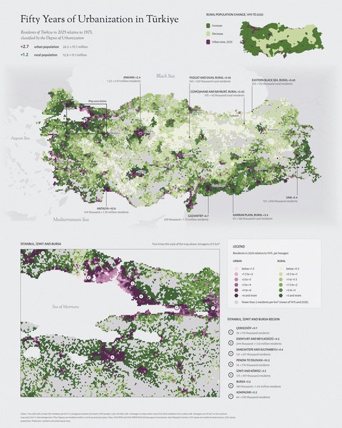</a>
<a href="https://oguzhankose.com/work/four-laps-of-an-enduro-loop/">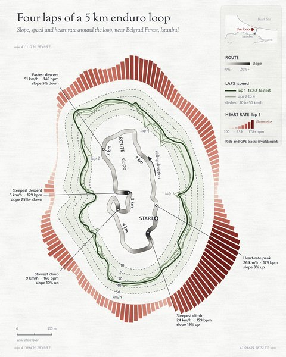</a>

<a href="https://oguzhankose.com/work/ai-is-the-new-black/">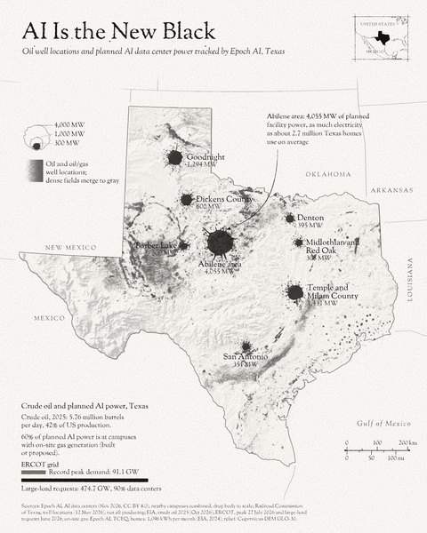</a>

All maps and the stories behind them: [oguzhankose.com](https://oguzhankose.com) · [X](https://x.com/kuzeyokumaps) · [Instagram](https://www.instagram.com/kuzeyoku/)
